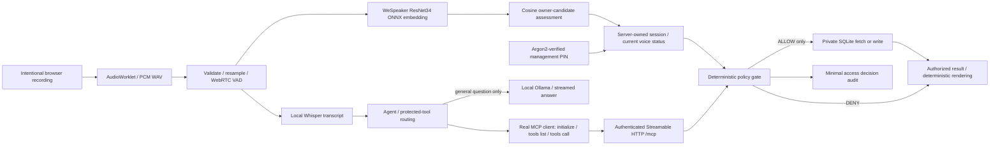

# Architecture

GuestGuard is a single-owner, local-first prototype. React is served by FastAPI after a Vite build; development can use Vite's same-origin proxy. SQLite schema v1 is safely initialized at startup. No cloud account is needed.

## Modules

| File | Responsibility |
| --- | --- |
| `backend/app/privacy.py` | Pure policy, mode calculation, voice state transitions |
| `database.py` | Parameterized repository, schema v1, persistence and retention |
| `security.py` | Session issuance, HMAC-derived MCP credential, PIN and encryption key |
| `tools.py` | Authorized data boundary and minimal audit |
| `mcp_server.py` | Ten SDK-registered tools and fresh server factory |
| `agent.py` | Actual SDK client, discovery, tool routing and result rendering |
| `ollama.py` | Local-only general-question model, with no MCP result in its prompt |
| `streaming.py` | Model token streaming and final policy recheck for tool results |
| `voice.py` | WAV validation, VAD, fbank, ONNX, encrypted enrollment and verification |
| `transcription.py` | Optional local faster-whisper English STT |
| `main.py` | Typed API, origin/host checks, browser cookie and exact MCP routes |
| `frontend/src/app/App.tsx` | Single Home view and Voice & PIN setup sharing server state |
| `frontend/src/components/AudioCapture.tsx` | User-initiated microphone, actual waveform and WAV encoding |

## Policy matrix

| Resource | Fresh owner match, clear room | No current match | Guest detected / room uncertain |
| --- | --- | --- | --- |
| PUBLIC read | ALLOW | ALLOW | ALLOW |
| PERSONAL | ALLOW without PIN | DENY | DENY |
| SENSITIVE | ALLOW without PIN | DENY | DENY |
| Unknown resource / locked / expired session | DENY | DENY | DENY |

`REDACT` is a reserved decision enum; this MVP chooses denial rather than partial private results. Public writes have no exposed tool. Reminder writes remain PERSONAL. The UI cannot weaken these invariants; audit retention is the only configurable policy.

## State transitions

New sessions start with UNCERTAIN identity and occupancy. A valid owner match clears restricted occupancy, including a prior detected guest, and opens private access without PIN. Unknown/uncertain/invalid voice input restricts access until the next valid owner match. Every new audio submission revokes prior voice candidate evidence before decoding. The encrypted owner template persists across sessions until replaced or deleted; enrollment and deletion require PIN verification. Candidate evidence expires at two minutes; management PIN verification at five minutes; application sessions at one hour.

Pending inference carries a request timestamp and enrollment version; newer input or enrollment changes prevent stale results from promoting identity. Policy checks and data reads share the repository lock. Enrollment rechecks independent authorization at template commit. Timeout workers can finish computation but cannot independently mutate voice session state.

MCP transport is stateless at the SDK HTTP layer, while application state is persistent and bound to a separate bearer credential. Every HTTP request authenticates that credential against a non-expired application session; every tool rechecks session and policy. Protocol negotiation was executed and asserted at 2025-11-25. Another MCP client can connect using a credential issued through the PIN-protected backend endpoint; the simplified Home UI does not expose it. OAuth discovery/onboarding for actual Alexa is outside this project.

General questions go to Ollama on loopback, using only the current question and a fixed system instruction. Protected requests remain on the MCP route. Ollama never receives tool results, calendar entries, notes, session state, voice data, or a private transcript history. The home page streams the model's generated text chunks as they arrive.

## Deployment

Local recommended workflow is in README. `compose.yaml` binds only loopback and persists encrypted templates and models in named volumes. After building, download models with `docker compose run --rm guestguard python -m scripts.setup_models`, then `docker compose up`. Docker was not installed in the implementation environment, so the container recipe is prepared but unverified. For public hosting, add a real authenticated bootstrap/OAuth design, TLS, deployment host configuration, secret management and resource limits; do not expose this local demo directly. No cloud deployment has occurred.

References: [MCP Python SDK](https://github.com/modelcontextprotocol/python-sdk), [WeSpeaker pretrained models](https://github.com/wenet-e2e/wespeaker/blob/master/docs/pretrained.md), [upstream ONNX fbank inference](https://github.com/wenet-e2e/wespeaker/blob/master/wespeaker/bin/infer_onnx.py), [faster-whisper](https://github.com/SYSTRAN/faster-whisper).
